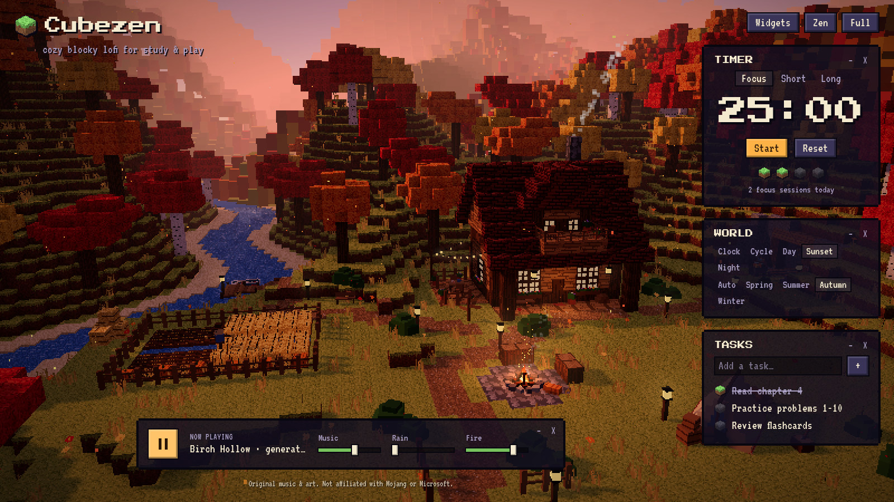
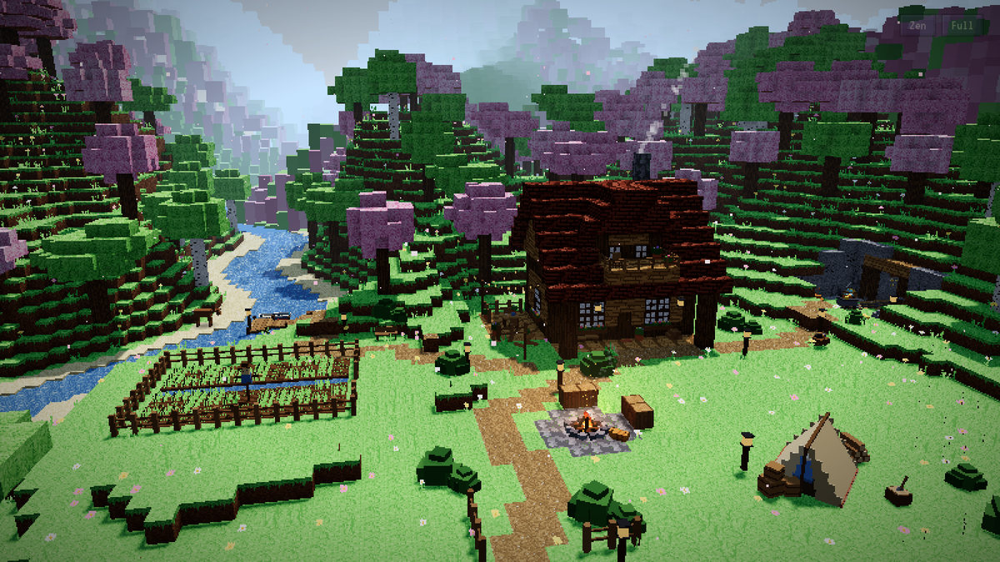
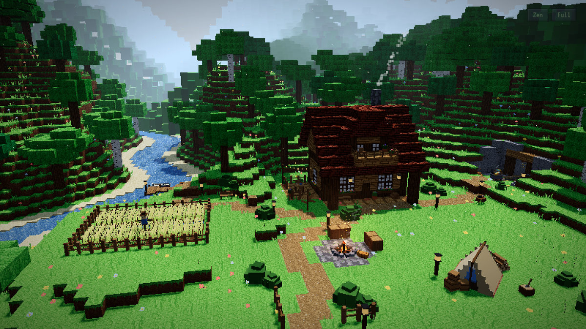
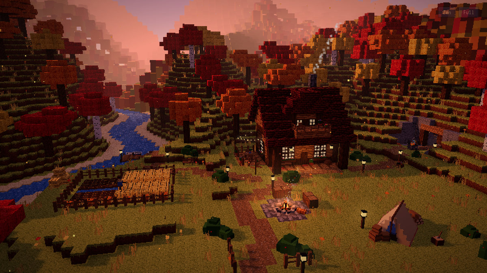
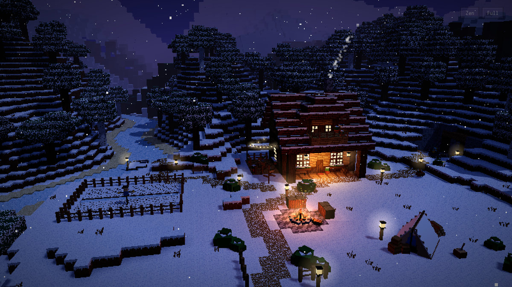
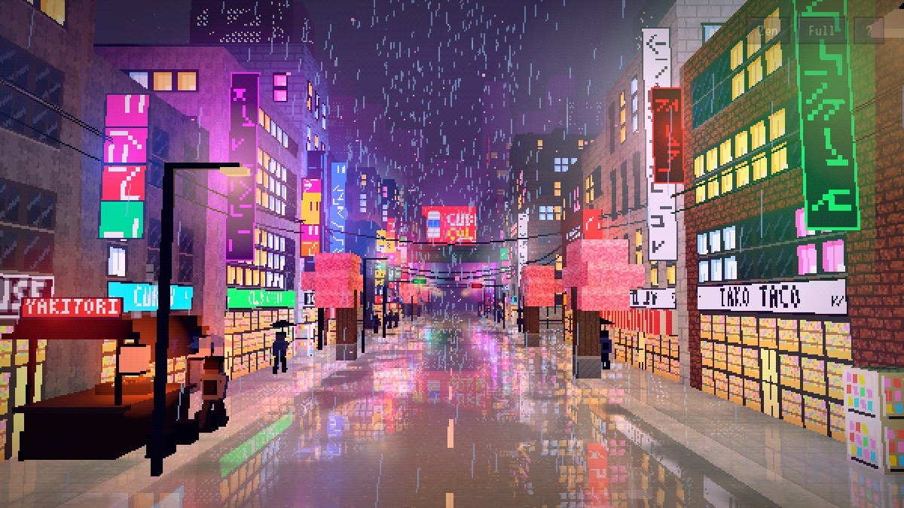
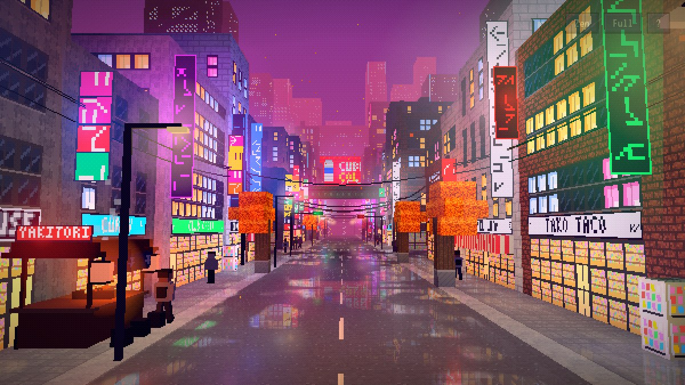

<div align="center">
  
  <h1>Cubezen</h1>
  <p><strong>A cozy voxel valley (or a neon city street) to study in, with piano that writes itself.</strong></p>
  <p>
    <a href="https://jgalilea.github.io/cubezen/"><strong>Open Cubezen</strong></a> ·
    <a href="#features">Features</a> ·
    <a href="#run-it-locally">Run it locally</a> ·
    <a href="#development">Development</a>
  </p>
</div>



Cubezen is a background page for focused work. Leave it open on a second screen: a 3D valley with a cabin, a campfire and a river, or a rainy neon shopping street, changes with the time of day and the seasons, while generative piano, rain and fire play over it. A pomodoro timer and a task list sit on top, and all of it hides away when you just want the view.

It runs entirely in the browser, with no sign-up. You can also install it as an app, and it keeps working offline.

All art and music are original. The music is composed and synthesised live in the browser with the Web Audio API, so there are no audio files and no third-party copyright. Not affiliated with Mojang or Microsoft.

## Features

- **A living valley**: a river with a dock and a painted rowboat, a farm plot with seasonal crops, a cabin with a smoking chimney, a balcony, a terrace under string lights and flower boxes, paths with lanterns and a signpost leading to the dock and the mine, a campfire on a stone hearth, a camping tent, a mine dug into the hillside with a loaded minecart and piles of ore, trees, bushes and flowers, and hills that carry the river off into the haze. A cat sleeps by the fire, butterflies come out on warm days, and visitors drop by, up to two at a time: a rabbit, a flock of birds, a family of ducks, a deer coming down to drink or a fox by day, and at night an owl on the scarecrow or a hedgehog warming up by the fire.
- **A neon city**: switch the World panel to **City** for a narrow shopping street at street level: towers of lit windows, vertical neon signs, tenant boards and rooftop signs in an invented glyph script, shopfronts and vending machines, utility poles with sagging cables, traffic lights, a railway bridge with a commuter train, and a big screen at the end of the street cycling through made-up adverts. The street is always a little wet and reflects the neon, more so in the rain, when people put their umbrellas up. Cars drive by with their lights on, and a yakitori stall with red lanterns grills on the pavement (its grill follows the Fire slider). Every name, sign and picture is made up.
- **Day and night**: synced to your clock by default, or a 20-minute cycle, or fixed at day, sunset or night, with sun, moon, stars, clouds and fireflies.
- **Seasons**: picked automatically from the date (the default) or chosen by hand. Colours, particles (petals, leaves, snow) and details of the world change; in winter the river freezes.
- **Generative music**: ever-new piano pieces, each with its own mode, motif and structure, in the spirit of calm game soundtracks.
- **Ambience**: rain and fire with their own volume; the rain and the campfire (the stall's grill in the city) follow their sliders.
- **Sleep timer**: fade all sound out after 15, 30, 45, 60 or 90 minutes; the music pauses and the sliders end at 0.
- **Pomodoro**: 25-minute focus with 5 and 15-minute breaks, a chime and a short note when time is up, and a count of today's sessions. Every fourth session leads to the long break. In its settings: 50/10 and 90/20 presets or your own lengths, starting the next phase on its own, and an optional notification that only shows when you're in another window. A running timer survives a reload or a closed tab.
- **Tasks**: a simple list for the session. Double-click to edit, drag the handle (or use the arrow keys on it) to reorder, and clear the finished ones in one go.
- **Installable and offline**: install it from the browser or the Widgets menu; after the first visit it opens without a connection.
- **Media keys**: play/pause from your keyboard, headphones or the system's media controls, which show the current piece.
- **Screen stays on** while the timer runs, so a tablet or laptop beside you doesn't go dark mid-session.
- **Light on your machine**: the 3D world stops drawing whenever the page can't be seen (another tab, minimized, a locked screen) while the sound keeps playing; shadows are only redrawn when the sun moves; the audio engine rests when everything is silent; and slow computers get slightly lighter graphics on their own.
- **Your own layout**: every widget can be minimized (`−`) or hidden (`×`); the music bar shrinks to just play/pause and the track; the **Widgets** menu brings hidden ones back, and the layout is remembered.
- **Zen mode**: hides the interface and leaves only the landscape.

### Through the year

| | |
| --- | --- |
|  |  |
|  |  |

### The city

| | |
| --- | --- |
|  |  |

Screenshots are from the real app, with sample tasks. The seasons and the city are shown in Zen mode.

### Shortcuts

| Key | Action |
| --- | --- |
| `Space` | Play or pause the music |
| `M` | Mute or unmute all sound |
| `Z` | Sleep timer: off, 15, 30, 45, 60, 90 minutes |
| `S` | Start or pause the timer |
| `R` | Reset the timer |
| `N` | Skip to the next phase |
| `T` | New task |
| `H` | Zen mode |
| `F` | Fullscreen |
| `?` | Show the shortcuts |

### Privacy

Preferences, tasks, stats and the running timer are saved in your browser (`localStorage`); there are no accounts and no server. The page loads Three.js from jsDelivr (the service worker keeps a copy for offline use); the fonts are served from the repository. Notifications are off unless you turn them on in the timer settings.

## Run it locally

The hosted version at https://jgalilea.github.io/cubezen/ is all you need to use it. To run your own copy you only need Python, or any other static file server, and a browser with WebGL:

```sh
git clone https://github.com/jgalilea/cubezen.git
cd cubezen
python3 -m http.server 8000
```

Then open http://localhost:8000. The 3D world uses ES modules, so serve the folder: opening `index.html` from disk leaves you with the interface but no world.

## Development

No build step and nothing to install: Three.js is loaded from a CDN through an import map.

### URL parameters

Handy for previews and screenshots. `scene`, `time`, `t`, `season`, `fire` and `rain` take priority over the World panel and the Fire and Rain sliders, so those controls won't change that value while the parameter is in the URL.

| Parameter | Effect |
| --- | --- |
| `?scene=valley\|city` | Fix the scene |
| `?time=day\|sunset\|night\|clock\|cycle` | Fix the time mode |
| `?t=0.72` | Start the cycle at a specific time (0 = midnight, 0.5 = noon) |
| `?season=spring\|summer\|autumn\|winter` | Fix the season |
| `?fire=0.8` | Fix the campfire (or grill) intensity (0 to 1) |
| `?rain=0.7` | Fix the rain (0 to 1) |
| `?critter=rabbit\|birds\|ducks\|deer\|fox\|owl\|hedgehog&advance=10` | Spawn a visitor in the valley and fast-forward it N seconds |
| `?shot` | Preserve the drawing buffer so the canvas can be read (screenshots) |

### Structure

- `index.html`: interface and the Three.js import map
- `css/style.css`: pixel-art UI
- `manifest.webmanifest`, `sw.js`, `icons/`: install metadata, the offline service worker and the app icons
- `fonts/`: Press Start 2P and VT323 (SIL Open Font License 1.1), self-hosted so the text doesn't jump on load
- `js/app.js`: mixer, sleep timer, pomodoro and its settings, tasks, world panel, widget layout, shortcuts and install
- `js/composer.js`: generative composer (modes, voicings, motifs, piece structure); pure JS, no audio
- `js/audio.js`: synthesised piano and pad that perform the composer's pieces, plus rain and fire
- `js/world/main.js`: the engine: rendering, sky, day/night lighting, seasons, rain and particles, and loading the scene
- `js/world/common.js`: helpers shared by the scenes (glows, clouds, keyframes, disposal)
- `js/world/valley/index.js`: the valley scene: water, campfire, lanterns, clouds, fireflies, and its lighting keyframes
- `js/world/valley/build.js`: voxel world generation and meshing with ambient occlusion
- `js/world/valley/textures.js`: procedural 16×16 px textures, repainted each season
- `js/world/valley/props.js`: the farm's fence, scarecrow, pumpkins and hay bales, the dock with its rowboat, the camp (tent, woodpile, crates), the mine's yard (rails, minecart, tools, ore) and the bushes and fences along the path
- `js/world/valley/critters.js`: the cat, the butterflies and the visitors
- `js/world/city/index.js`: the city scene: materials with baked neon light, the wet-street reflections, signs, the big screen and its lighting keyframes
- `js/world/city/build.js`: the street, buildings, facades, bridge and towers as a voxel grid, meshed with ambient occlusion and per-vertex neon light
- `js/world/city/textures.js`: procedural city textures and their glowing twin (lit windows, shop glass, neon tubes), repainted each season
- `js/world/city/signs.js`: the pixel font, the invented glyph script, the sign atlas and the animated screen
- `js/world/city/props.js`: street lamps, utility poles and cables, traffic lights and the yakitori stall
- `js/world/city/life.js`: people with umbrellas, cars and the train
- `docs/screenshots/`: the images in this README

## Deployment

GitHub Pages serves the `main` branch straight from the repository root.

## License

Copyright (C) 2026 Javier Galilea. Released under the [GNU General Public License v3.0](LICENSE).
